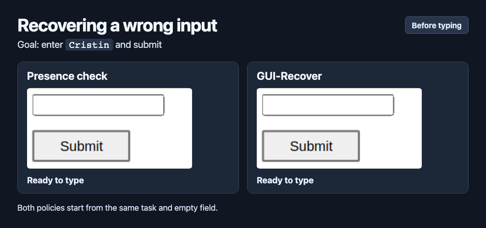

# GUI-Recover

**English** · [简体中文](README.zh-CN.md)

**Fault injection, recovery, and replay for visual GUI agents.**

<a name="demo"></a>



The MiniWoB++ task asks for `Cristin`. An injected fault changes the input to `cristin`. The presence-only baseline sees text in the field and submits. GUI-Recover compares the rendered letters with the intended input, then replaces the text before submitting. The animation uses cropped screenshots from the recorded pair. [Source frames and decision logs](examples/visual-text-content-pair/provenance.json)

[CPU quick start](#quick-start) · [Reproduce the demo](#reproduce-the-miniwob-gpu-comparison) · [Benchmarks](#benchmarks) · [Releases](https://github.com/ljk-777/GUI-Recover/releases)

<a name="安装与本地验收"></a>

## Quick start

Try the trailing-space demo on CPU with Python 3.11 and Chromium. It generates its own fixtures and needs no model weights or API key.

```bash
git clone https://github.com/ljk-777/GUI-Recover.git
cd GUI-Recover
python3.11 -m venv .venv
source .venv/bin/activate
python -m pip install -e .
python -m playwright install chromium
gui-recover demo-tail-probe --out runs/tail-demo
```

The clean field and the field with a trailing space start with identical pixels. A reversible keyboard selection exposes the final character, so the demo can repair the corrupted field and leave the clean field untouched. Compare the selected PNGs and open `runs/tail-demo/summary.json` for the exact submission results. Use a fresh output directory to run it again.

| Clean input | Injected trailing space |
| --- | --- |
|  |  |

[Shared starting screenshot](examples/rc3-tail-selection/before.png) · [Demo protocol and verified outputs](docs/TAIL_PROBE_PORTABILITY.md)

To smoke-test the MiniWoB++ execution and trace pipeline, run `bash scripts/demo_cpu.sh runs/miniwob-smoke`. It uses a diagnostic oracle on simple click tasks. [Environment setup](docs/SERVER.md)

<a name="what-gui-recover-measures"></a>

## What you can test

- **Input and action recovery in MiniWoB++.** Inject missed clicks, dropped input, or corrupted text. Compare a baseline with a visual check, a targeted retry, or a reversible probe. Model-backed runs use ShowUI for visual grounding.
- **Answer verification research in VisualWebArena.** The Classifieds research branch asks Qwen to locate evidence, read a screenshot crop, and verify its answer before submission. The tasks keep native grading. [Research branch protocol](https://github.com/ljk-777/GUI-Recover/blob/cdc54ef4525f1ec2338ba0fdb521f167dc409b25/docs/MULTISTEP_RECOVERY.md)
- **Auditable comparisons.** Match strategies by task, seed, and budget. Each run saves proposed and executed actions, screenshots, and rewards. To try an offline replay, open `examples/recovered/replay.html` locally after cloning. The CPU auditor can reconstruct supported decisions from recorded files. [More recorded examples](examples/README.md)

<a name="selected-results"></a>

## Benchmarks

| Evaluation | Recorded outcome |
| --- | --- |
| MiniWoB++ input corruption across six layouts | The visual check recovered 18/18 visible errors and the presence-only baseline recovered 0/18. The checker rewrote none of the six clean inputs. [Paired outcomes](docs/VISUAL_TEXT_CONTENT.md#正式结果) |
| Native MiniWoB++ text variants | Active verification scored 24/24, compared with 20/24 for glyph comparison. Unconditional replacement also scored 24/24 and performed eight more rewrites than active verification. [Protocol and trade-offs](docs/TAIL_PROBE_PORTABILITY.md#transfer-to-native-miniwob-task-variants) |
| VisualWebArena Classifieds research branch | Two development replays scored 2/2 with evidence checking and 0/2 with the baseline. On the fresh eight-task evaluation, both scored 0/8, with zero wrong submissions for evidence checking and one for the baseline. [Development scores](https://github.com/ljk-777/GUI-Recover/blob/cdc54ef4525f1ec2338ba0fdb521f167dc409b25/examples/vwa-reference-retrieval-development-results.json) · [Fresh evaluation](https://github.com/ljk-777/GUI-Recover/blob/cdc54ef4525f1ec2338ba0fdb521f167dc409b25/examples/vwa-fresh-heldout-results.json) |

<a name="gpu-最小恢复演示"></a>

## Reproduce the MiniWoB++ GPU comparison

After the CPU setup, use one BF16-capable CUDA GPU and the pinned ShowUI-2B weights. This runs seven conditions with both strategies on the animation's seed.

```bash
python -m pip install -e '.[showui]'
bash scripts/setup_miniwob.sh
python scripts/download_showui.py --out models/ShowUI-2B
export MINIWOB_URL="file://$PWD/vendor/miniwob-plusplus/miniwob/html/miniwob/"
CUDA_VISIBLE_DEVICES=0 HF_HUB_OFFLINE=1 TRANSFORMERS_OFFLINE=1 \
  gui-recover text-recovery --model models/ShowUI-2B --seeds 69000 --out runs/text-recovery
gui-recover audit-text-recovery runs/text-recovery
```

[Environment setup](docs/SERVER.md) · [Active input verification](docs/ACTIVE_TEXT_VERIFICATION.md)

<a name="research-and-contributions"></a>

## Contribute

For a bug or new recovery strategy, include the task and seed, the command you ran, and a small trace. The project also includes experimental SFT adapters and offline and online RL studies. [Contribution guide](CONTRIBUTING.md) · [SFT](docs/SFT_RECOVERY.md) · [Offline RL](docs/RECOVERY_OFFLINE_RL.md) · [Online RL](docs/ONLINE_VISUAL_RECOVERY_RL.md)

GUI-Recover is licensed under Apache-2.0 and builds on ShowUI, BrowserGym, MiniWoB++, and VisualWebArena. [License](LICENSE) · [Third-party notices](THIRD_PARTY.md)
