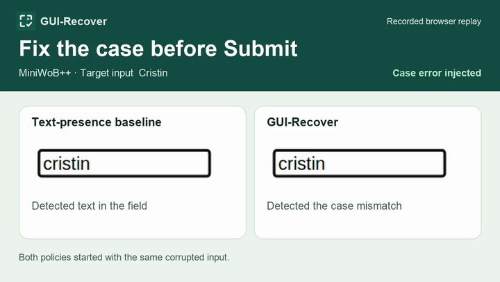
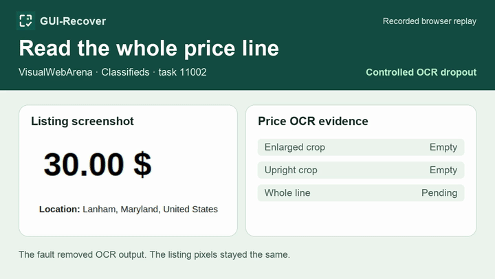
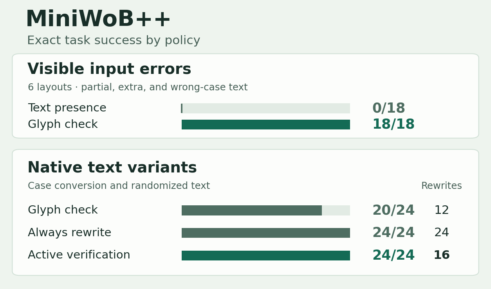
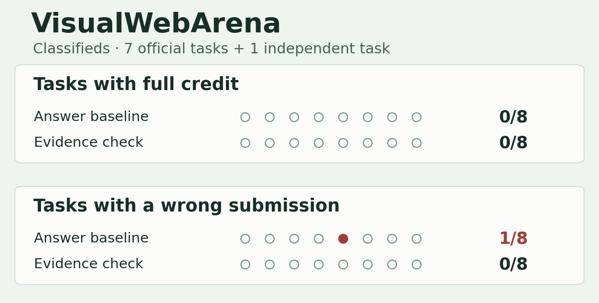
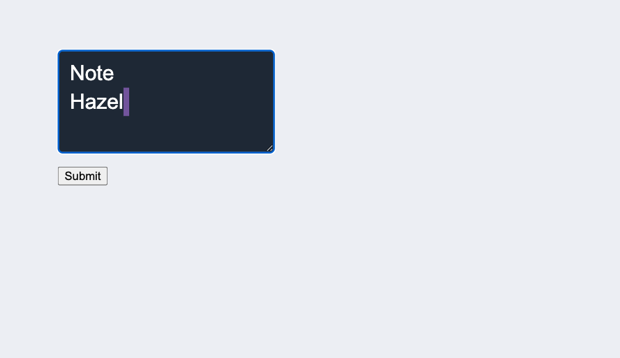

<p align="center"></p>

<h1 align="center">GUI-Recover</h1>

<p align="center"><strong>Detect and recover from visual GUI agent errors</strong></p>

<p align="center">
  <strong>English</strong> · <a href="README.zh-CN.md">简体中文</a> ·
  <a href="#demo">Demos</a> · <a href="#benchmarks">Benchmarks</a> · <a href="#quick-start">CPU quick start</a> ·
  <a href="https://github.com/ljk-777/GUI-Recover/releases">Releases</a>
</p>

<a name="demo"></a>

## See it in action

### Repair a wrong input before submission

[](examples/readme-demo/miniwob-case-replay.en.webm)

The screenshot check catches the case mismatch and restores `Cristin` before the browser submits. [Watch MP4](examples/readme-demo/miniwob-case-replay.en.mp4) · [Recorded trace](examples/visual-text-content-pair/provenance.json) · [Reproduce the run](#reproduce-the-miniwob-gpu-comparison)

### Recover a price when both detectors return empty

[](examples/readme-demo/vwa-ocr-replay.en.webm)

In this controlled fault run, a whole-line read recovers `30.00 $` from the listing screenshot. The native judge accepts the price and city. [Watch MP4](examples/readme-demo/vwa-ocr-replay.en.mp4) · [Video sources and checksums](examples/readme-demo/replay-media-provenance.json)

<a name="selected-results"></a>

## Benchmarks

### MiniWoB++ input recovery



Active verification matched the success count of unconditional rewriting with eight fewer rewrites on the native text variants. In the visible-error study, the glyph check left all six clean inputs untouched. [Visible-error protocol and data](docs/VISUAL_TEXT_CONTENT.md#正式结果) · [Native variant protocol and data](docs/TAIL_PROBE_PORTABILITY.md#transfer-to-native-miniwob-task-variants)

### VisualWebArena price and city recovery



Each dot represents one task and a filled dot means full native credit. In cohort 010, both policies received the same screenshots and Qwen replies. Whole-line recognition recovered the four injected failures with one extra CPU OCR read per task and zero wrong submissions. The earlier search-and-navigation cohort scored 0/8 with both policies. [Controlled fault results](examples/vwa-catalog-price-transfer-results-010.json) · [Protocol and replay](docs/MULTISTEP_RECOVERY.md#test-recovery-when-both-price-detector-reads-are-empty) · [Earlier navigation results](examples/vwa-fresh-heldout-results.json)

A higher-resolution scan reached 192 listings and enrolled zero fresh double detector failures. [Natural-trigger screening](examples/vwa-price-retry-holdout-screening-011.json)

<a name="安装与本地验收"></a>

## Quick start

Try the trailing-space demo on CPU with Python 3.11 and Chromium. It generates its own fixtures and needs no model weights or API key.

```bash
git clone https://github.com/ljk-777/GUI-Recover.git
cd GUI-Recover
python3.11 -m venv .venv
source .venv/bin/activate
python -m pip install -e .
python -m playwright install chromium
gui-recover demo-tail-probe --out runs/tail-demo
```

Open `runs/tail-demo/report.html` to compare the selected screenshots and exact submission results. The clean and faulted fields start with identical pixels. A reversible selection exposes the final character so the policy can identify the extra space before submission. Use a fresh output directory to run it again.

| Clean input | Injected trailing space |
| --- | --- |
|  |  |

[Shared starting screenshot](examples/rc3-tail-selection/before.png) · [Demo protocol and verified outputs](docs/TAIL_PROBE_PORTABILITY.md)
· [Release candidate validation](docs/RELEASE_CANDIDATE_RC4.md)

To smoke-test the MiniWoB++ execution and trace pipeline, run `bash scripts/demo_cpu.sh runs/miniwob-smoke`. It uses a diagnostic oracle on simple click tasks. [Environment setup](docs/SERVER.md)

<a name="what-gui-recover-measures"></a>

## What you can test

- **Input and action recovery in MiniWoB++.** Inject missed clicks, dropped input, or corrupted text. Compare a baseline with a visual check, a targeted retry, or a reversible probe. Model-backed runs use ShowUI for visual grounding.
- **Answer verification in VisualWebArena.** Run Qwen with screenshot-grounded evidence checks, targeted OCR rereads and native grading on a Classifieds instance you control. [CUDA setup and evaluation](docs/MULTISTEP_RECOVERY.md#inspect-visualwebarena-recordings)
- **Auditable comparisons.** Match strategies by task, seed, and budget. Each run saves proposed and executed actions, screenshots, and rewards. To try an offline replay, open `examples/recovered/replay.html` locally after cloning. The CPU auditor can reconstruct supported decisions from recorded files. [More recorded examples](examples/README.md)

<a name="gpu-最小恢复演示"></a>

## Reproduce the MiniWoB++ GPU comparison

After the CPU setup, use one BF16-capable CUDA GPU and the pinned ShowUI-2B weights. This runs seven conditions with both strategies on the animation's seed.

```bash
python -m pip install -e '.[showui]'
bash scripts/setup_miniwob.sh
python scripts/download_showui.py --out models/ShowUI-2B
export MINIWOB_URL="file://$PWD/vendor/miniwob-plusplus/miniwob/html/miniwob/"
CUDA_VISIBLE_DEVICES=0 HF_HUB_OFFLINE=1 TRANSFORMERS_OFFLINE=1 \
  gui-recover text-recovery --model models/ShowUI-2B --seeds 69000 --out runs/text-recovery
gui-recover audit-text-recovery runs/text-recovery
```

[Environment setup](docs/SERVER.md) · [Active input verification](docs/ACTIVE_TEXT_VERIFICATION.md)

<a name="research-and-contributions"></a>

## Contribute

For a bug or new recovery strategy, include the task and seed, the command you ran, and a small trace. The project also includes experimental SFT adapters and offline and online RL studies. [Contribution guide](CONTRIBUTING.md) · [SFT](docs/SFT_RECOVERY.md) · [Offline RL](docs/RECOVERY_OFFLINE_RL.md) · [Online RL](docs/ONLINE_VISUAL_RECOVERY_RL.md)

GUI-Recover is licensed under Apache-2.0 and builds on ShowUI, BrowserGym, MiniWoB++, and VisualWebArena. [License](LICENSE) · [Third-party notices](THIRD_PARTY.md)
