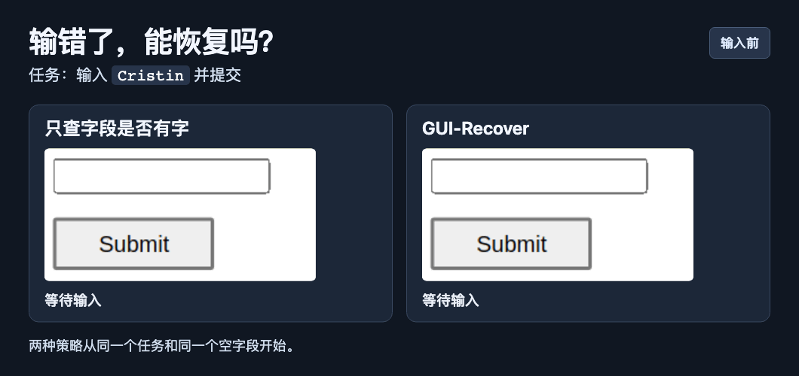
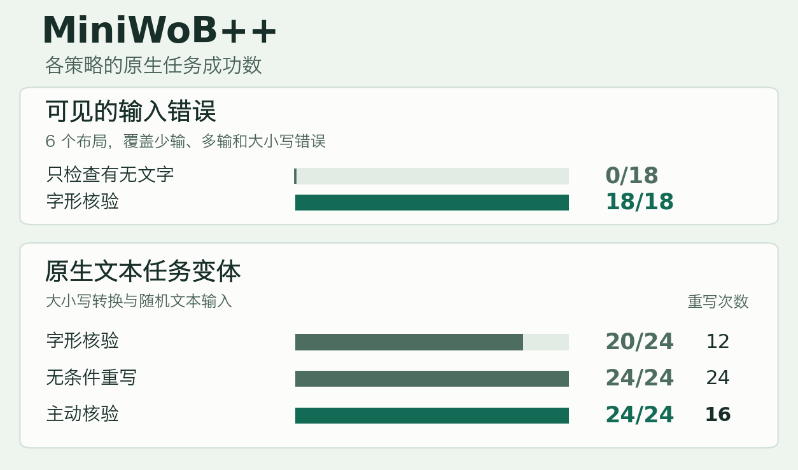
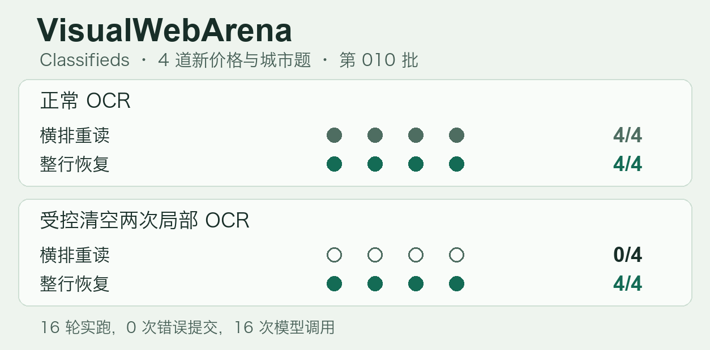

<h1 align="center">GUI-Recover</h1>

<p align="center"><strong>检测并恢复 GUI 智能体的操作错误</strong></p>

<p align="center">
  <a href="README.md">English</a> · <strong>简体中文</strong> ·
  <a href="#评测结果">评测结果</a> · <a href="#cpu-快速开始">CPU 快速开始</a> ·
  <a href="https://github.com/ljk-777/GUI-Recover/releases">版本发布</a>
</p>

<a name="演示"></a>



同样的故障把两边的 `Cristin` 改成了 `cristin`。基线直接提交错误文本。GUI-Recover 从截图中发现大小写不符，在提交前纠正了输入。 [原始截图与决策记录](examples/visual-text-content-pair/provenance.json) · [单卡复现这组演示](#单卡复现-miniwob-对照)

## 评测结果

### MiniWoB++ 输入恢复



在原生文本任务变体中，主动核验和无条件重写的成功数相同，主动核验少重写 8 次。在可见错误实验中，字形核验保留了全部 6 个正常输入。 [可见错误实验](docs/VISUAL_TEXT_CONTENT.md#正式结果) · [原生任务变体实验](docs/TAIL_PROBE_PORTABILITY.md#transfer-to-native-miniwob-task-variants)

### VisualWebArena 价格与城市核验



每个圆点代表一道题，实心表示获得原生满分。第 010 批中，两版使用相同的截图和 Qwen 回复。整行识别每题额外做一次 CPU OCR，救回全部四次受控故障，错误提交为零。此前的搜索与导航新题中，两版均为 0/8。 [故障注入结果](examples/vwa-catalog-price-transfer-results-010.json) · [协议与复现](docs/MULTISTEP_RECOVERY.md#test-recovery-when-both-price-detector-reads-are-empty) · [早期导航结果](examples/vwa-fresh-heldout-results.json)

高分辨率批次筛查了 192 个商品，未入组新的双重 OCR 失败。 [自然触发筛选结果](examples/vwa-price-retry-holdout-screening-011.json)

## CPU 快速开始

用 Python 3.11 和 Chromium 跑一个末尾空格恢复演示。演示会生成自己的测试页面，只用 CPU，无需模型权重或 API 密钥。

```bash
git clone https://github.com/ljk-777/GUI-Recover.git
cd GUI-Recover
python3.11 -m venv .venv
source .venv/bin/activate
python -m pip install -e .
python -m playwright install chromium
gui-recover demo-tail-probe --out runs/tail-demo
```

打开 `runs/tail-demo/report.html`，并排查看选中截图和提交结果。正常输入和多了末尾空格的输入，初始截图逐像素相同。一次可撤销的键盘选中操作让末尾空格可见，策略据此决定是否修复。重跑时请换一个输出目录。

| 正常输入 | 注入末尾空格 |
| --- | --- |
|  |  |

[共用的初始截图](examples/rc3-tail-selection/before.png) · [演示方案与验收记录](docs/TAIL_PROBE_PORTABILITY.md)
· [发布候选验收](docs/RELEASE_CANDIDATE_RC4.md)

要单独检查 MiniWoB++ 的动作执行和轨迹记录，可以运行 `bash scripts/demo_cpu.sh runs/miniwob-smoke`。这组点击任务由诊断策略执行。 [系统依赖安装](docs/SERVER.md)

## 可以测什么

- **MiniWoB++ 动作和输入恢复。** 注入点偏、漏输或错输，对比原策略、截图核验、针对性重试和可撤销探测。模型实验用 ShowUI 定位界面元素。
- **VisualWebArena 作答核验。** 在自托管的 Classifieds 环境中，用 Qwen 定位截图证据、按需重读 OCR 字段，并保留上游评分。 [CUDA 环境与评测复现](docs/MULTISTEP_RECOVERY.md#inspect-visualwebarena-recordings)
- **可审计的配对实验。** 两套策略共用任务、随机种子与预算。每次运行都会保存动作提案、实际执行、截图和评分。克隆后在本地打开 `examples/recovered/replay.html` 即可看一条漏输入恢复轨迹，还能用 CPU 审计工具复核受支持的决策。 [更多回放样例](examples/README.md)

## 单卡复现 MiniWoB++ 对照

完成 CPU 安装后，用一张支持 BF16 的 CUDA 显卡和固定版本的 ShowUI-2B。下面指定动图使用的种子，在七种条件下跑两套策略。

```bash
python -m pip install -e '.[showui]'
bash scripts/setup_miniwob.sh
python scripts/download_showui.py --out models/ShowUI-2B
export MINIWOB_URL="file://$PWD/vendor/miniwob-plusplus/miniwob/html/miniwob/"
CUDA_VISIBLE_DEVICES=0 HF_HUB_OFFLINE=1 TRANSFORMERS_OFFLINE=1 \
  gui-recover text-recovery --model models/ShowUI-2B --seeds 69000 --out runs/text-recovery
gui-recover audit-text-recovery runs/text-recovery
```

[服务器环境和国内镜像](docs/SERVER.md) · [主动输入核验](docs/ACTIVE_TEXT_VERIFICATION.md)

## 参与贡献

提交问题或新的恢复策略时，可以附上任务、种子、运行命令和一小段轨迹。仓库也保留了 SFT、离线强化学习和在线强化学习的实验记录。 [贡献指南](CONTRIBUTING.md) · [SFT](docs/SFT_RECOVERY.md) · [离线强化学习](docs/RECOVERY_OFFLINE_RL.md) · [在线强化学习](docs/ONLINE_VISUAL_RECOVERY_RL.md)

GUI-Recover 采用 Apache-2.0 许可证，基于 ShowUI、BrowserGym、MiniWoB++ 和 VisualWebArena。 [许可证](LICENSE) · [第三方许可](THIRD_PARTY.md)
