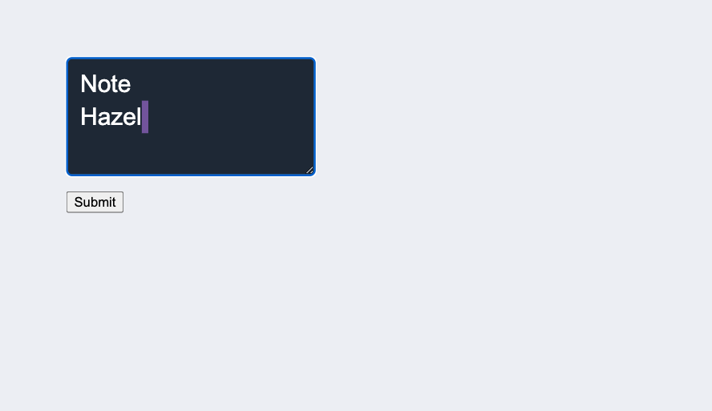

# GUI-Recover

[English](README.md) · **简体中文**

**面向视觉 GUI 智能体的故障注入、恢复与回放工具。**

<a name="演示"></a>


在这条 MiniWoB++ 任务中，原本要输入 `Cristin`，注入的故障把首字母改成了小写。基线看到字段里有字就提交了。GUI-Recover 对照截图里的字形和目标文本，在提交前纠正了输入。动图取自这一组实际运行的截图。 [原始帧与决策记录](examples/visual-text-content-pair/provenance.json)

[CPU 快速开始](#cpu-快速开始) · [单卡复现](#单卡复现-miniwob-对照) · [评测结果](#评测结果) · [版本发布](https://github.com/ljk-777/GUI-Recover/releases)

## CPU 快速开始

用 Python 3.11 和 Chromium 跑一个末尾空格恢复演示。演示会生成自己的测试页面，只用 CPU，无需模型权重或 API 密钥。

```bash
git clone https://github.com/ljk-777/GUI-Recover.git
cd GUI-Recover
python3.11 -m venv .venv
source .venv/bin/activate
python -m pip install -e .
python -m playwright install chromium
gui-recover demo-tail-probe --out runs/tail-demo
```

正常输入和多了一个末尾空格的输入，初始截图逐像素相同。用一次可撤销的键盘选中操作，就能看出选中的是末尾字符还是空白。打开输出中的选中截图和 `runs/tail-demo/summary.json`，可以核对修复动作和提交结果。重跑时请换一个输出目录。

| 正常输入 | 注入末尾空格 |
| --- | --- |
|  |  |

[共用的初始截图](examples/rc3-tail-selection/before.png) · [演示方案与验收记录](docs/TAIL_PROBE_PORTABILITY.md)

## 可以测什么

- **MiniWoB++ 动作和输入恢复。** 注入点偏、漏输或错输，对比原策略、截图核验、针对性重试和可撤销探测。模型实验用 ShowUI 定位界面元素。
- **VisualWebArena 作答证据核对。** 在 Classifieds 任务中让 Qwen 先定位证据、读取截图裁剪区域，再复核候选答案后提交。任务沿用上游评分。
- **可审计的配对实验。** 两套策略共用任务、随机种子与预算。每次运行都会保存动作提案、实际执行、截图和评分。克隆后在本地打开 `examples/recovered/replay.html` 即可看一条漏输入恢复轨迹，还能用 CPU 审计工具复核受支持的决策。 [更多回放样例](examples/README.md)

## 评测结果

| 评测 | 实测结果 |
| --- | --- |
| MiniWoB++ 六个布局的输入出错测试 | 18 个可见错误中，字形核验修复了 18 个，只检查有无文字的基线修复了 0 个。字形核验没有重写 6 个正常输入。 [配对结果](docs/VISUAL_TEXT_CONTENT.md#正式结果) |
| MiniWoB++ 原生文本任务变体 | 主动核验通过 24/24，字形对照通过 20/24。无条件重写也通过 24/24，比主动核验多重写 8 次。 [实验方案和开销](docs/TAIL_PROBE_PORTABILITY.md#transfer-to-native-miniwob-task-variants) |
| VisualWebArena Classifieds | 两道开发旧题的证据策略得分为 2/2，基线为 0/2。八道新题上双方均为 0/8，证据策略错误提交 0 次，基线错误提交 1 次。 [开发复跑](examples/vwa-reference-retrieval-development-results.json) · [新题评测](examples/vwa-fresh-heldout-results.json) |

## 单卡复现 MiniWoB++ 对照

完成 CPU 安装后，用一张支持 BF16 的 CUDA 显卡和固定版本的 ShowUI-2B。下面指定动图使用的种子，在七种条件下跑两套策略。

```bash
python -m pip install -e '.[showui]'
bash scripts/setup_miniwob.sh
python scripts/download_showui.py --out models/ShowUI-2B
export MINIWOB_URL="file://$PWD/vendor/miniwob-plusplus/miniwob/html/miniwob/"
CUDA_VISIBLE_DEVICES=0 HF_HUB_OFFLINE=1 TRANSFORMERS_OFFLINE=1 \
  gui-recover text-recovery --model models/ShowUI-2B --seeds 69000 --out runs/text-recovery
gui-recover audit-text-recovery runs/text-recovery
```

[服务器环境和国内镜像](docs/SERVER.md) · [主动输入核验](docs/ACTIVE_TEXT_VERIFICATION.md) · [VisualWebArena 复现细节](docs/MULTISTEP_RECOVERY.md)

## 参与贡献

提交问题或新的恢复策略时，可以附上任务、种子、运行命令和一小段轨迹。仓库也保留了 SFT、离线强化学习和在线强化学习的实验记录。 [贡献指南](CONTRIBUTING.md) · [SFT](docs/SFT_RECOVERY.md) · [离线强化学习](docs/RECOVERY_OFFLINE_RL.md) · [在线强化学习](docs/ONLINE_VISUAL_RECOVERY_RL.md)

GUI-Recover 采用 Apache-2.0 许可证，基于 ShowUI、BrowserGym、MiniWoB++ 和 VisualWebArena。 [许可证](LICENSE) · [第三方许可](THIRD_PARTY.md)
